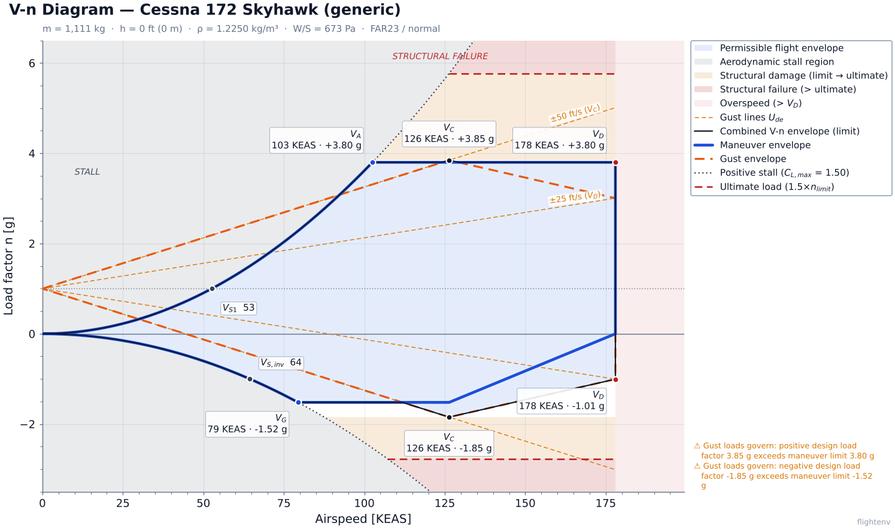
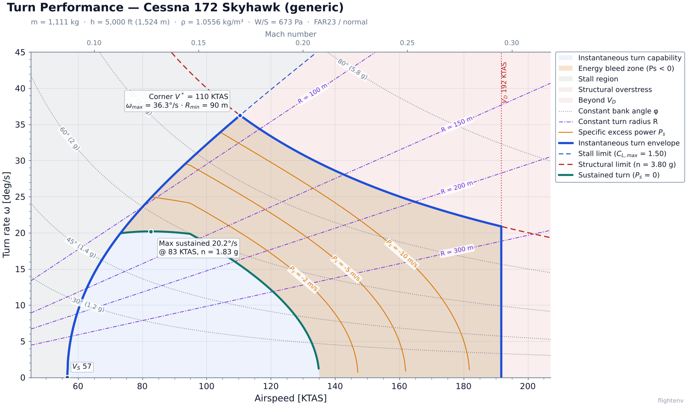
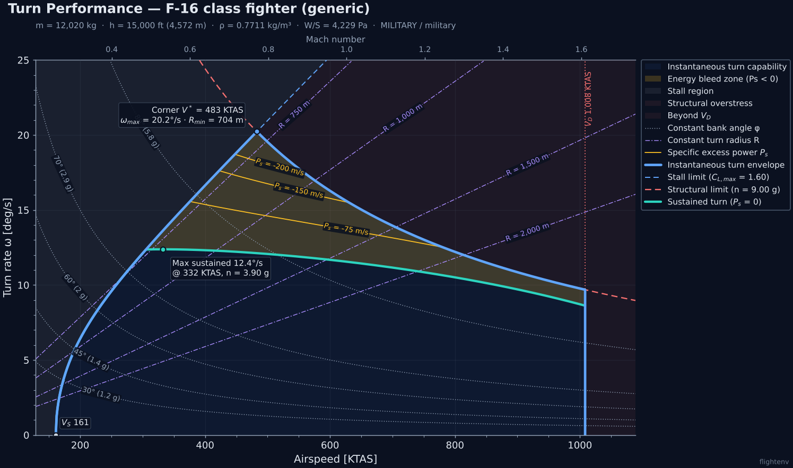
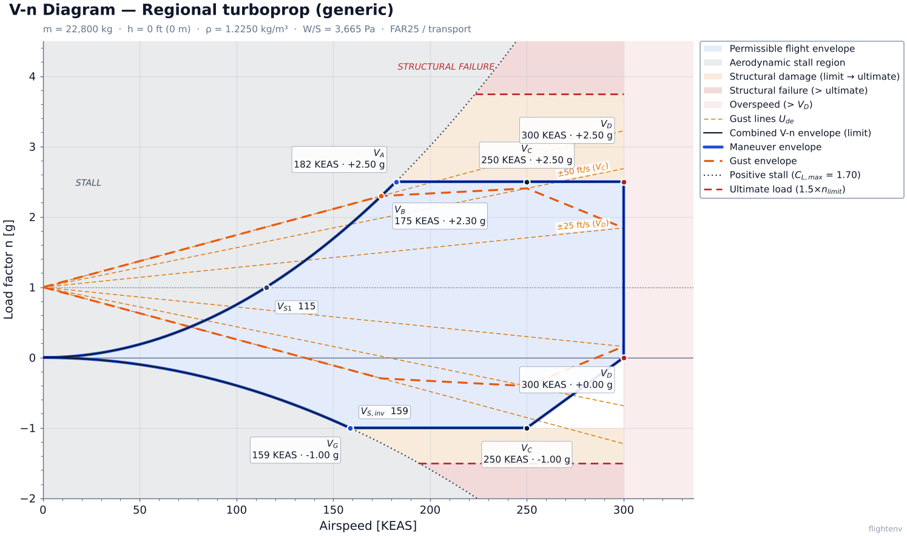
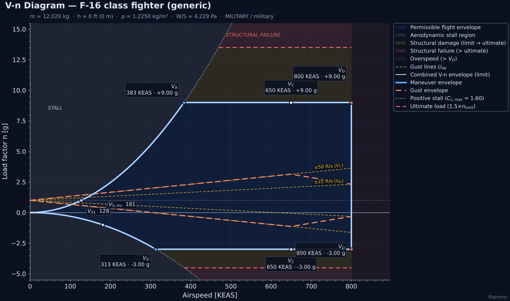
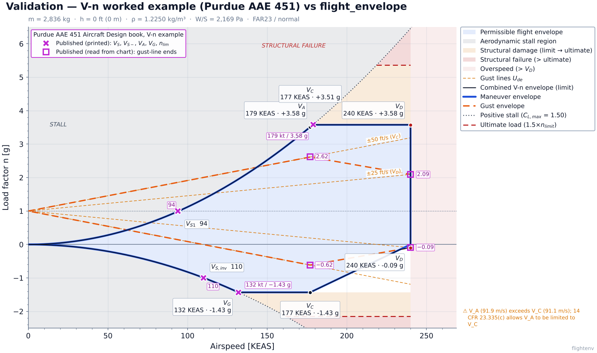
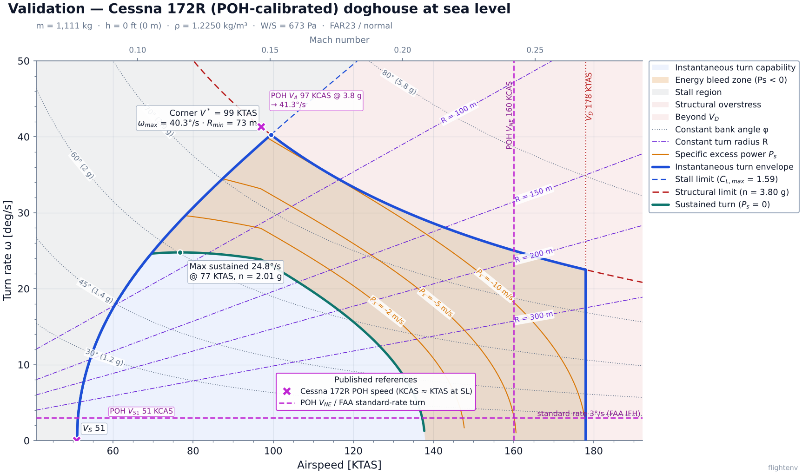

# flight-envelope · `flightenv`

**Aircraft flight-envelope calculator.** It computes V-n diagrams and turn-performance (doghouse / E-M) diagrams from a short YAML description of an airplane. It draws them as publication-quality charts and exports every curve as structured JSON/CSV, so you can rebuild the chart in your own tools.

<p align="center">
  
</p>

```bash
flightenv vn -c examples/cessna172.yaml -o vn.png -e vn.json
```

---

## Features

**V-n diagram (maneuver + gust)**
- Maneuver envelope: positive/negative stall parabolas against the structural limits, with design speeds V_S1, V_A, V_G, V_C, V_D (and V_B for FAR 25).
- Pratt-formula gust lines and gust envelope per 14 CFR 23.341 / 25.341, including the gust alleviation factor K_g, mass ratio μ_g, and the reduction of U_de with altitude.
- A combined design boundary that tells you whether maneuver or gust loads govern, the ultimate (1.5×) envelope, and shaded stall, structural-damage, structural-failure and overspeed zones.
- Limit load factors from 23.337 / 25.337 when you don't supply them.

**Turn performance (doghouse / energy-maneuverability)**
- Instantaneous limits from C_L,max and the structural g limit, plus the V_D dynamic-pressure limit.
- Sustained-turn boundary (P_s = 0) from a parabolic drag polar and a jet or propeller thrust model.
- Specific-excess-power (P_s) bleed contours, constant-bank-angle and constant-radius isolines, corner speed, and a secondary Mach axis.

**Engineering plumbing**
- The physics, the data contract and the rendering are separate layers. The charts are drawn *only* from the exported data model.
- SI internally. Inputs can carry units (`"2450 lb"`, `"126 kt"`, `"180 hp"`). Output in kt / m/s / km/h / mph, EAS or TAS, metres or feet.
- PNG/SVG/PDF at 300 dpi, light and dark themes, and interactive Plotly HTML.
- Typer + Rich CLI with summary tables, progress bars and engineering warnings.
- 160 tests, checked against ISA tables, FAR formulas and textbook kinematics. See [Validation](#validation).

## Gallery

| | |
|---|---|
|  |  |
| **Turn performance**: Cessna 172 class, 5,000 ft. P_s contours, bank-angle and radius isolines. | **Turn performance**: F-16 class, 15,000 ft, dark theme, with a Mach axis. |
|  |  |
| **V-n, FAR 25 transport**: regional turboprop with V_B and the 66 ft/s gust line. | **V-n, military**: F-16 class, +9 / −3 g, dark theme. |

Regenerate all of these with `python scripts/make_gallery.py`.

## Install

Requires Python ≥ 3.10.

```bash
git clone https://github.com/bmorrisey/flight-envelope-cli
cd flight-envelope-cli
pip install -e ".[dev]"          # use ".[interactive]" if you only want Plotly HTML output
```

## Quick start

```bash
# V-n diagram with chart and data export
flightenv vn -c examples/f16.yaml --altitude 0 -o vn_diagram.png -e vn_data.json -e vn_data.csv

# Turn-performance diagram at 5,000 ft, knots, radius in feet, plus interactive HTML
flightenv turn -c examples/cessna172.yaml --altitude 5000 --unit-speed knots -l ft \
    -o turn_doghouse.png --interactive

# Inspect / validate a configuration
flightenv info -c examples/f16.yaml

# JSON Schema of the export contract (or of the aircraft config)
flightenv schema envelope -o envelope.schema.json
```

Example terminal output:

```text
            V-n key speeds — Cessna 172 Skyhawk (generic) @ 0 ft
┏━━━━━━━━━┳━━━━━━━━━━━━━━━━━━━━━━━━━━━━┳━━━━━━━┳━━━━━━━┳━━━━━━━━━┳━━━━━━━━━━┓
┃ Speed   ┃ Description                ┃  KEAS ┃  KTAS ┃ m/s EAS ┃ km/h EAS ┃
┡━━━━━━━━━╇━━━━━━━━━━━━━━━━━━━━━━━━━━━━╇━━━━━━━╇━━━━━━━╇━━━━━━━━━╇━━━━━━━━━━┩
│ V_S1    │ Stall speed (1 g)          │  52.6 │  52.6 │    27.1 │     97.4 │
│ V_A     │ Maneuvering / corner speed │ 102.5 │ 102.5 │    52.7 │    189.9 │
│ V_C     │ Design cruise speed        │ 126.3 │ 126.3 │    65.0 │    234.0 │
│ V_D     │ Design dive speed          │ 178.0 │ 178.0 │    91.6 │    329.7 │
└─────────┴────────────────────────────┴───────┴───────┴─────────┴──────────┘
╭─────────────────────────────── Warnings ───────────────────────────────╮
│ • Gust loads govern: positive design load factor 3.85 g exceeds        │
│   maneuver limit 3.80 g                                                │
╰────────────────────────────────────────────────────────────────────────╯
```

### CLI options

| Option | Commands | Meaning |
|---|---|---|
| `-c/--config` | all | Aircraft YAML/JSON |
| `-a/--altitude`, `--alt-unit ft\|m` | vn, turn | ISA altitude (default ft) |
| `-m/--mass "2200 lb"` | all | Override the configured mass |
| `-u/--unit-speed kt\|m/s\|km/h\|mph` | vn, turn | Speed axis unit |
| `--speed-type eas\|tas` | vn, turn | V-n defaults to EAS, turn defaults to TAS |
| `-l/--unit-length m\|ft` | turn | Turn radius and P_s units |
| `--bank-angles 30,45,60` · `--radii 500,1000` · `--ps -20,-50` | turn | Overlay levels (chosen automatically if omitted) |
| `-o/--output` | vn, turn | `.png` / `.svg` / `.pdf`, or `.html` for Plotly |
| `-e/--export-data` | vn, turn | `.json` or `.csv`; repeatable |
| `-t/--theme light\|dark`, `--dpi 300` | vn, turn | Styling |
| `-i/--interactive` | vn, turn | Also write a Plotly HTML chart and open it |
| `--points 600` | vn, turn | Speed-grid resolution |
| `-q/--quiet` | vn, turn | No tables or progress bars |

Exit code 2 means invalid input (bad config, unit or altitude).

## Aircraft configuration

YAML or JSON, optionally wrapped in a top-level `aircraft:` key. **Bare numbers are SI. Strings may carry units.** Design speeds are **equivalent airspeeds**.

```yaml
aircraft:
  name: "Cessna 172 Skyhawk (generic)"
  category: normal          # normal | utility | aerobatic | commuter | transport | military
  mass: "2450 lb"
  wing_area: 16.2           # m^2
  wing_chord: 1.49          # m, mean geometric chord (gust mass ratio)
  aspect_ratio: 7.32
  oswald_efficiency: 0.80
  cd0: 0.027
  cl_max_clean: 1.50
  cl_min_clean: -1.00
  lift_curve_slope: 4.8     # 1/rad   (or "0.084 /deg")
  max_power_sl: "180 hp"    # propeller: T = eta * P(sigma) / V
  prop_efficiency: 0.78
  max_thrust_sl: 2100.0     # N; with a propeller this is the static-thrust cap
  v_c: "126 kt"
  v_d: "178 kt"
  n_pos_limit: 3.8          # optional: defaults from 14 CFR 23.337 / 25.337
  n_neg_limit: -1.52
```

| Field | Default / notes |
|---|---|
| `max_thrust_sl` (jet) | `T = T_SL · σ^m`, with `thrust_lapse_exponent` m = 0.7 |
| `max_power_sl` (propeller) | Gagg-Ferrar power lapse `P/P_SL = 1.132σ − 0.132` |
| `v_d` | 1.25 V_C |
| `v_b` | FAR 25: where the 66 ft/s gust line meets the stall curve, capped at V_C |
| `n_pos_limit` | `2.1 + 24000/(W_lb + 10000)`, clamped to 2.5–3.8 · utility 4.4 · aerobatic 6.0 · military 7.33 |
| `n_neg_limit` | −0.4 n (normal/utility) · −0.5 n (aerobatic) · −1.0 (transport) · −3.0 (military) |
| `n_neg_at_vd` | 0 (normal/commuter/transport) · −1 (utility/aerobatic/military) |
| `ultimate_factor` | 1.5 |
| `gust:` | `u_b/u_c/u_d` and their 50,000 ft values: 66/50/25 → 38/25/12.5 ft/s |

Bundled examples:

| File | What it exercises |
|---|---|
| [`examples/cessna172.yaml`](examples/cessna172.yaml) | FAR 23 normal category, propeller, gust-governed loads |
| [`examples/f16.yaml`](examples/f16.yaml) | Military jet, +9/−3 g, high T/W, units given as strings |
| [`examples/regional_turboprop.yaml`](examples/regional_turboprop.yaml) | FAR 25, derived V_B, 66 ft/s gust line |

## Python API

```python
from flight_envelope import OutputUnits, load_aircraft, turn_envelope, vn_envelope
from flight_envelope.plotting.vn_plot import plot_vn, render_vn

ac = load_aircraft("examples/cessna172.yaml")

raw, data = vn_envelope(ac, altitude_m=0.0, units=OutputUnits(speed="kt", speed_type="eas"))
raw.speeds["va"]                 # 52.7  (SI engine output, m/s EAS)
data.key_points["Va"]            # KeyPoint(x=102.5, y=3.8, label='$V_A$', ...)
data.summary["n_design_pos"]     # ScalarResult(value=3.85, unit='g', ...)

data.to_json("vn.json"); data.to_csv("vn.csv")
plot_vn(data, "vn.svg", theme="dark")
fig = render_vn(data)            # matplotlib Figure for further customisation

raw_t, turn = turn_envelope(ac, altitude_m=1524, units=OutputUnits(speed_type="tas", length="ft"))
```

The physics modules can be used on their own: `aero.atmosphere.isa()`, `aero.vn.compute_vn()`, `aero.turn.compute_turn()`, `aero.turn.turn_rate()`, `aero.vn.gust_alleviation_factor()`, and so on.

## Data contract: `EnvelopeData`

All curves, regions and key points are exported in one Pydantic model (`flightenv schema envelope` prints the JSON Schema):

```jsonc
{
  "schema_version": "1.0",
  "envelope_type": "vn_diagram",               // | "turn_performance"
  "aircraft_name": "Cessna 172 Skyhawk (generic)",
  "flight_conditions": {"altitude_m": 0, "density_kg_m3": 1.225, "mass_kg": 1111, "regulation": "far23", ...},
  "units": {"speed": "KEAS", "load_factor": "g", "gust_velocity": "ft/s"},
  "x_axis": {"label": "Airspeed [KEAS]", "unit": "KEAS", "min": 0, "max": 199.4},
  "y_axis": {"label": "Load factor n [g]", "unit": "g", "min": -3.5, "max": 6.5},
  "key_points": {"Va": {"x": 102.52, "y": 3.8, "label": "$V_A$", "description": "Design maneuvering (corner) speed"}},
  "summary":    {"va": {"value": 102.52, "unit": "KEAS", "label": "V_A", "description": "..."}},
  "boundaries": [{"id": "maneuver_envelope", "label": "...", "role": "maneuver", "x_unit": "KEAS", "y_unit": "g",
                  "points": [{"x": 0, "y": 0}, ...], "line_style": "solid", "line_width": 2.6,
                  "color_hint": "cobalt", "inline_label": null, "show_in_legend": true}],
  "contours":   [ /* gust lines, bank-angle / radius / Ps isolines */ ],
  "regions":    [{"id": "structural_failure_pos", "role": "structural_failure", "points": [...],
                  "color_hint": "crimson", "opacity": 0.16}],
  "safe_region_polygon": [{"x": 0, "y": 0}, ...],
  "warnings": ["Gust loads govern: ..."],
  "palette": {"light": {"cobalt": "#1D4ED8", ...}, "dark": {...}}
}
```

- `color_hint` is a palette token. Resolve it with `palette[theme][token]`.
- Labels use Matplotlib mathtext (`$V_A$`). [`plotting/interactive.py`](flight_envelope/plotting/interactive.py) is a compact reference client that turns any `EnvelopeData` into Plotly.
- CSV export is long-format: `kind,id,label,index,x,y,x_unit,y_unit`.

**Stable ids**

| Envelope | Boundaries / contours | Regions |
|---|---|---|
| V-n | `maneuver_envelope`, `combined_envelope`, `gust_envelope`, `positive_stall`, `negative_stall`, `ultimate_pos/neg`, `gust_{vb,vc,vd}_{pos,neg}`, `level_flight` | `safe_envelope`, `stall_pos/neg`, `structural_damage_pos/neg`, `structural_failure_pos/neg`, `overspeed` |
| Turn | `instantaneous_envelope`, `aerodynamic_limit`, `structural_limit`, `sustained_limit`, `q_limit`, `bank_<deg>`, `radius_<R><unit>`, `ps_<value>` | `safe_envelope`, `energy_depletion`, `stall_region`, `overstress`, `overspeed` |

## Theory

<details>
<summary><b>V-n diagram equations</b></summary>

| Quantity | Expression |
|---|---|
| Stall curve | n = ½ ρ₀ V_e² S C_L / W |
| Stall / maneuvering speed | V_S1 = √(2W / ρ₀ S C_L,max), V_A = V_S1 √n_pos |
| Gust mass ratio | μ_g = 2 (W/S) / (ρ c̄ g C_Lα) (actual density) |
| Gust alleviation factor | K_g = 0.88 μ_g / (5.3 + μ_g) |
| Gust increment | Δn = ρ₀ V_e C_Lα K_g U_de / (2 W/S) |
| Combined boundary | upper = min(stall⁺, max(n_pos, 1 + Δn)), lower = max(stall⁻, min(n_neg(V), 1 − Δn)) |

</details>

<details>
<summary><b>Turn performance equations</b></summary>

| Quantity | Expression |
|---|---|
| Kinematics | n = 1/cos φ, ω = g√(n²−1)/V, R = V²/(g√(n²−1)) |
| Aerodynamic limit | n = q C_L,max / (W/S) |
| Corner speed | V* = √(2 n_lim W / ρ S C_L,max) (maximum ω, minimum R) |
| Drag | D = q S C_D0 + K n² W² / (q S), K = 1/(π AR e) |
| Sustained | n_s = √((T − q S C_D0) q S / (K W²)) |
| Excess power | P_s = V (T − D) / W |

</details>

## Validation

The test suite checks the engines against public references: US Standard Atmosphere 1976 tables, the 14 CFR 23.337 load-factor formula, the FAR 23 imperial gust formula (`Δn = K_g U_de V a / (498 W/S)`), and textbook level-turn kinematics. It also checks internal consistency: T = D along the sustained boundary, ω·R = V, and that the combined envelope contains the maneuver envelope.

We also compared the results against **published data** (`python validation/run_validation.py`): **27 of 28 checks pass**. Full method, citations and a discussion of each discrepancy are in **[docs/validation.md](docs/validation.md)**.

| Check | Published | flightenv | Error |
|---|---:|---:|---:|
| Purdue AAE 451 V-n worked example: n₊ / n₋ | 3.58 / −1.43 | 3.577 / −1.431 | < 0.1 % |
| ″ V_S / V_A / V_G | 94 / 179 / 132 kt | 94.5 / 178.6 / 131.9 kt | < 0.5 % |
| ″ gust-line ends at V_C and V_D (read from the chart) | 2.62 / −0.62 / 2.09 / −0.09 g | 2.614 / −0.614 / 2.094 / −0.094 g | ≤ 0.006 g |
| Cessna 172R POH, calibrated C_L,max: V_A at 2450 lb | 97 KCAS | 99.4 | +2.5 % |
| Cessna 172S POH: V_A weight scaling 2200 / 1900 lb | 0.933 / 0.857 | 0.929 / 0.863 | < 0.8 % |
| FAA IFH standard-rate bank at 100 / 120 KTAS (rule of thumb) | 15° / 18° | 15.4° / 18.2° | < 2.4 % |
| Generic `examples/cessna172.yaml`: V_A | 97 KCAS | 102.5 | **+5.7 % (fail)**: assumed C_L,max, not a code error |

Published values are drawn as magenta markers on our own charts. No third-party chart images are reproduced.

| | |
|---|---|
|  |  |
| Textbook V-n worked example: published points (magenta) on our envelope. | Cessna 172R (POH-calibrated) doghouse with POH V_S1, V_A and V_NE and the FAA standard-rate turn. |

Not yet validated: the sustained-turn (P_s = 0) boundary and the P_s contours, and fighter E-M data in general. We found no published F-16 E-M chart that states weight and drag index.

## Modelling notes and limitations

- **Atmosphere:** ISA from 0 to 86 km. Input altitude is geometric and converted to geopotential. Standard day only.
- **V-n:** the maneuver envelope is altitude-independent in EAS. Altitude enters through μ_g (actual ρ) and the reduction of U_de above 20,000 ft. Gusts use the Pratt formula (FAR 23, and FAR 25 before Amdt 25-86). The tuned 1-cos discrete gust and continuous turbulence of current Part 25 are **not** modelled.
- **Ultimate load** = `ultimate_factor` × the governing design limit (maneuver ∪ gust).
- **Turn performance** uses an incompressible parabolic polar with no Mach effect on thrust or drag. Results above roughly M 0.7 are optimistic. Turns are level, coordinated and at constant weight.
- Example aircraft are **generic, illustrative configurations**, not manufacturer data. Do not use for flight operations or certification.

## Development

```bash
pip install -e ".[dev]"
pytest -q                          # ~4 s
python scripts/make_gallery.py     # regenerate README images after visual changes
```

Project layout:

```
flight_envelope/
├── units.py              # unit parsing and display-unit conversion
├── palette.py            # colour tokens shared by renderers and exported data
├── aero/                 # pure physics, SI, numpy-vectorised
│   ├── atmosphere.py     # ISA
│   ├── propulsion.py     # jet / propeller thrust available
│   ├── vn.py             # V-n engine (VnResult)
│   └── turn.py           # turn engine (TurnResult)
├── models/
│   ├── aircraft.py       # Aircraft input schema + loader
│   └── outputs.py        # EnvelopeData export contract
├── envelopes.py          # raw results → EnvelopeData (the only unit-conversion layer)
├── plotting/             # style.py, vn_plot.py, turn_plot.py, interactive.py
└── cli/main.py           # Typer app
```

Contributors and AI coding agents: read **[AGENTS.md](AGENTS.md)** first.
