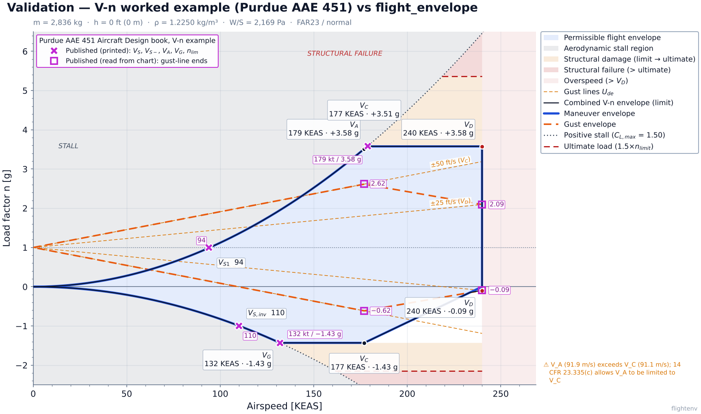
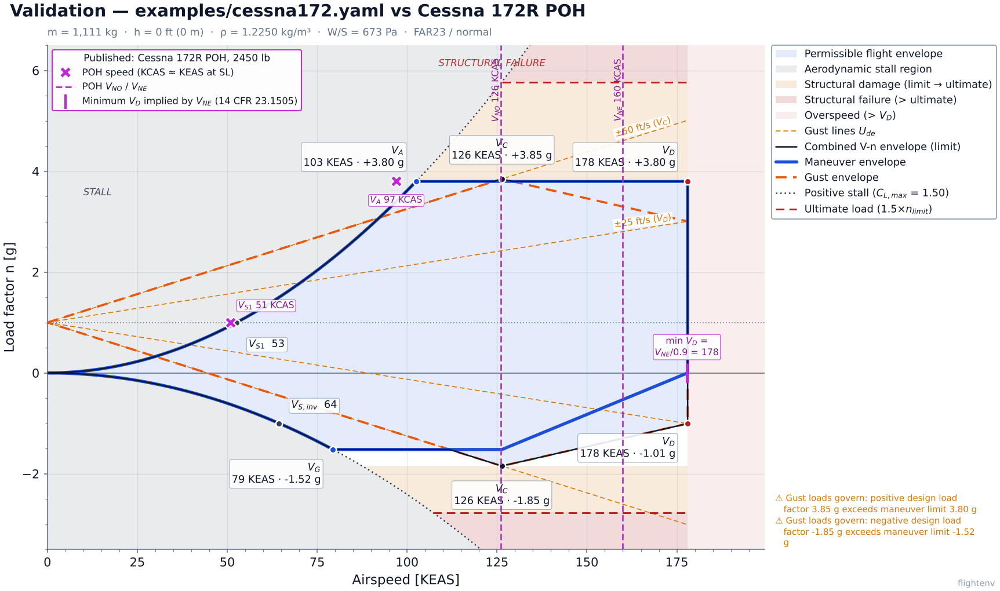
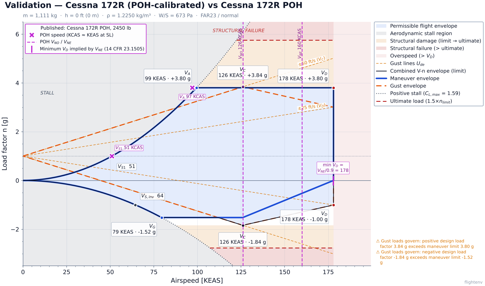
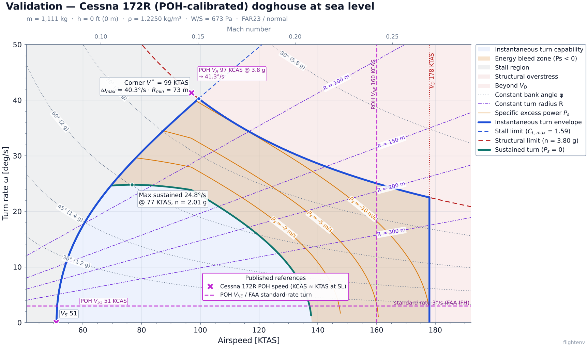
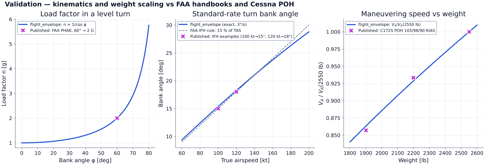

# Validation against published data

This page compares `flight_envelope` results with published V-n and turn-performance numbers.
Everything here can be regenerated with:

```bash
pip install -e .
python validation/run_validation.py
```

The script reads [`validation/reference_data.yaml`](../validation/reference_data.yaml), where each
reference value carries its source, conditions, units and confidence. It recomputes the package
results, prints the comparison table and writes
[`validation/results.json`](../validation/results.json) plus the figures below. The package's own
renderers (`render_vn`, `render_turn`, fed from `EnvelopeData`) draw the figures, and the
published values are overlaid as **magenta markers** (✖ printed/tabulated value, □ value read
from a chart, dashed magenta line for published speed limits).

No published chart images or text excerpts are reproduced. Only numbers were extracted, and
each one is cited.

## Method

1. **Find a source that gives a number and the conditions it applies to.** The best kind is a
   worked example that lists all of its inputs, because the package can then be run on exactly
   those inputs (case 1). Handbook values for a real aircraft (POH) are weaker: they test the
   inputs we chose as much as the code (cases 2–4).
2. **Build the configuration.** Worked-example inputs go into `validation/aircraft/*.yaml`, with
   comments that trace each value to its source.
3. **Compare.** Each reference has an explicit check: an absolute tolerance equal to the source's
   printed or chart-read resolution, a percentage band for POH comparisons, an inequality for
   regulatory relations, or `info` for a value that was used as a calibration input.
4. **Confidence labels.**
   * `printed`: a number printed in the source, compared at its printed resolution.
   * `chart_read`: read by eye from a published figure (±0.05 g here).
   * `poh_snippet`: a Cessna POH table value seen in search-engine extracts of several
     independent POH copies. The session's network policy blocked the PDFs themselves, so
     check these against an original POH before relying on them.
   * `regulation`: a 14 CFR relation (e.g. V_NE ≤ 0.9 V_D).
   * `rule_of_thumb`: an FAA handbook approximation.

## Sources

| Id | Citation | Access |
|---|---|---|
| `purdue_aae451` | Computational Design (CODE) Laboratory, Purdue University (L. Leifsson), *Aircraft Design* Jupyter Book (AAE 451), section "V-n Diagram", `book/trade_study/vn_diagram.ipynb`. <https://computationaldesignlab.github.io/aircraft-design/trade_study/vn_diagram.html> | Public GitHub repository, commit `c405a64` (2025-11-26). Printed outputs read directly. GPL-3.0. |
| `cessna_172r_poh` | Cessna, *Pilot's Operating Handbook*, Model 172R, Sec. 2 Limitations, Sec. 5 Stall Speeds (2450 lb) | Search extracts of POH copies (e.g. wayman.edu/files/172R-POH.pdf). PDF not fetched. |
| `cessna_172s_poh` | Cessna, *Pilot's Operating Handbook*, Model 172S, Sec. 2 / Sec. 5 (2550 lb) | Search extracts of POH copies (wayman.edu, befa.org). PDF not fetched. |
| `cessna_172_load_factors` | Cessna 172 POH / AFM supplements, "Flight Load Factors": normal category +3.8 / −1.52 g flaps up | Search extracts of several AFM supplements |
| `cfr_23_1505` | 14 CFR 23.1505 (pre-Amdt 23-64): V_NE ≤ 0.9 V_D, V_NO ≤ V_C | CFR text via reprints |
| `cfr_23_337` | 14 CFR 23.337: n = 2.1 + 24000/(W+10000), 2.5 ≤ n ≤ 3.8; n_neg = −0.4 n | Also quoted by the Purdue notebook |
| `faa_phak_1980` | FAA, *Pilot's Handbook of Aeronautical Knowledge*, AC 61-23 (1980): 60° bank gives n = 2 | rosap.ntl.bts.gov/view/dot/71502. Same statement in FAA-H-8083-25C ch. 5 |
| `faa_ifh` | FAA, *Instrument Flying Handbook* (FAA-H-8083-15B): standard rate 3°/s; bank ≈ 15 % of TAS (15° at 100 kt, 18° at 120 kt) | Search extract quoting the handbook |

## Results

Result: **27 pass, 1 fail**. The one failure (V_A of the *generic* C172 example is 5.7 % above
the POH) comes from the example's assumed C_L,max, not from the code; with C_L,max calibrated to
the POH stall speed the same quantity agrees within 2.5 % (case 3). The first run of this
exercise also flagged the example's V_D as too low (159 KEAS, below the 172R's V_NE); the
example has since been corrected to 178 KEAS.

### 1. Textbook worked example: Purdue AAE 451 V-n diagram (strongest test)

The notebook builds a FAR 23 V-n diagram at sea level, MTOW and clean configuration with its
own imperial-unit implementation (the `498·W/S` form of the Pratt gust equation). Its inputs
went into [`validation/aircraft/purdue_aae451_example.yaml`](../validation/aircraft/purdue_aae451_example.yaml):
W/S = 45.3 lb/ft², S = 138 ft², mean geometric chord 3.92 ft, C_Lα = 5.1 /rad,
C_L,max = 1.5 / −1.1, V_C = 177 KEAS, V_D = 240 KEAS.

| Quantity | Published | flight_envelope | Error | Confidence |
|---|---:|---:|---:|---|
| n₊ (23.337) | 3.58 | 3.577 | −0.09 % | printed |
| n₋ | −1.43 | −1.431 | −0.05 % | printed |
| V_S+ (1 g) | 94 kt | 94.45 kt | +0.48 % | printed (integer kt) |
| V_S− (−1 g) | 110 kt | 110.3 kt | +0.26 % | printed |
| V_A | 179 kt | 178.6 kt | −0.21 % | printed |
| V_G | 132 kt | 131.9 kt | −0.06 % | printed |
| n, +50 ft/s gust at V_C | 2.62 | 2.614 | −0.006 g | chart read (±0.05 g) |
| n, −50 ft/s gust at V_C | −0.62 | −0.614 | +0.006 g | chart read |
| n, +25 ft/s gust at V_D | 2.09 | 2.094 | +0.004 g | chart read |
| n, −25 ft/s gust at V_D | −0.09 | −0.094 | −0.004 g | chart read |
| Positive gust governs? | no | no | ✓ | printed text |
| V_A > V_C? | yes | yes (warning issued) | ✓ | printed text |

Every value agrees within the source's own resolution. The source's text states one result,
that the −25 ft/s gust at V_D is the only gust that goes outside the maneuver envelope, and the
package reproduces it: the combined lower boundary at V_D is −0.09 g, against 0 g for the
maneuver envelope alone. The −5 % relative error on −0.09 g is a 0.004 g difference on a number
read off a chart. The small remaining differences come from constants: the notebook uses
g = 32.2 ft/s² and kt = 1.688 ft/s, the package uses g₀ = 9.80665 m/s² exactly.



A note on the source itself: the notebook's parameter table lists W/S = 42.8 lb/ft², but its
code uses 45.3, and so do all of its printed outputs. We follow the code. The notebook does not
print MTOW. W = 45.3 × 138 = 6251 lb reproduces its printed n₊ = 3.58, and any W in
6162–6271 lb would round to the same value.

### 2. `examples/cessna172.yaml` vs the Cessna 172R POH (2450 lb)

The shipped example is a *generic* 172-like aircraft. Its C_L,max, polar and design speeds are
assumed values, not Cessna data. POH speeds are KCAS. At sea level and M < 0.25, CAS and EAS
differ by less than 0.1 kt, so they are compared directly with KEAS.

| Quantity | Published | Ours | Error | Result |
|---|---:|---:|---:|---|
| V_S1 (flaps up, power off) | 51 KCAS | 52.6 | +3.1 % | within ±5 % |
| V_A at 2450 lb | 97 KCAS | 102.5 | +5.7 % | **outside ±5 %** |
| n₊ / n₋ (flaps up) | +3.8 / −1.52 | +3.8 / −1.52 | 0 | inputs |
| V_C ≥ V_NO (23.1505(b)) | ≥ 126 | 126.3 | | ✓ |
| V_D ≥ V_NE/0.9 (23.1505(a)) | ≥ 177.8 | 178.0 | +0.1 % | ✓ (fixed, was 159.4) |



* **V_D in the example was too low (fixed).** The original `v_d: 82 m/s` (159 KEAS) was *below*
  the 172R's published V_NE of 160 KCAS. 14 CFR 23.1505(a) requires V_NE ≤ 0.9 V_D, so a real 172
  has V_D ≥ 178 KEAS. This was an input-data error in `examples/cessna172.yaml`, not a code bug;
  the example now uses `v_d: "178 kt"`.
* **V_A is 5.7 % high** because V_S1 is 3 % high (V_A = V_S1·√3.8). The example's
  C_L,max = 1.50 is a little lower than the 172R's effective clean C_L,max.

### 3. POH-calibrated 172R ([`validation/aircraft/cessna172r_poh_calibrated.yaml`](../validation/aircraft/cessna172r_poh_calibrated.yaml))

Three inputs are set from published data. C_L,max = 1.595 gives V_S1 = 51 KCAS, V_C = V_NO =
126 KEAS is the smallest V_C allowed, and V_D = 178 KEAS is the smallest V_D allowed. V_S1 is
then a calibration input and is not scored. **V_A is not an input:** the package derives it from
V_S1 and n = 3.8.

| Quantity | Published | Ours | Error |
|---|---:|---:|---:|
| V_A at 2450 lb | 97 KCAS | 99.4 KEAS | +2.5 % |
| Doghouse corner speed at SL (= V_A in TAS) | 97 KCAS | 99.4 KTAS | +2.5 % |



The remaining +2.5 % (2.4 kt) is expected and does not point to a code error. Cessna's V_A is
not exactly V_S1·√n with the POH's tabulated V_S1:

* The POH V_S1 is a flight-test *CAS* value for one CG and the power-off condition. The
  certification V_A (23.335(c)) is computed from the stall speed at design weight using the
  normal-force coefficient C_N,max, and may be rounded down conservatively.
* The POH speeds are rounded to 1 kt, and the snippet values could not be checked against the
  original PDF.



On the turn diagram, the POH V_A sits on the 3.8 g structural line 1 °/s above our corner,
because it is at 97 rather than 99 KTAS. The FAA standard-rate turn (3 °/s) appears as a
reference line. The sustained-turn boundary (24.8 °/s at 77 KTAS, n = 2.0) and the P_s
contours have **no published reference**. They depend on the assumed polar (C_D0 = 0.027,
e = 0.80) and the propeller model, and should be treated as illustrative.

### 4. Kinematics and weight scaling

| Quantity | Published | Ours | Error | Confidence |
|---|---:|---:|---:|---|
| n at 60° bank (PHAK) | 2.0 | 2.000 | 0 | printed |
| Standard-rate bank at 100 KTAS (IFH) | 15° | 15.36° | +0.36° | rule of thumb |
| Standard-rate bank at 120 KTAS (IFH) | 18° | 18.24° | +0.24° | rule of thumb |
| V_A(2200 lb)/V_A(2550 lb), C172S | 98/105 = 0.933 | 0.929 | −0.48 % | POH (KIAS) |
| V_A(1900 lb)/V_A(2550 lb), C172S | 90/105 = 0.857 | 0.863 | +0.71 % | POH (KIAS) |
| V_S1 at 2550 lb, C172S | 53 KCAS | 53.7 | +1.25 % | POH |



The IFH "15 % of TAS" rule is a linearisation of tan φ = ωV/g, so the exact result is expected to
differ from it slightly. The V_A ratios test the √W scaling independently of C_L,max. Their
±0.7 % scatter matches what Cessna's rounding to whole knots, applied in indicated airspeed,
would produce.

## What agreement means, and what it doesn't

**It shows:**

* The FAR 23 V-n construction is implemented consistently with an independent worked
  example: the limit-load formula, stall curves, corner speeds, Pratt gust lines with K_g and
  μ_g, and the combination of maneuver and gust envelopes, including the negative gust at V_D.
  The match is within the source's printed resolution (better than 0.5 %).
* The EAS/stall-speed/V_A relations and their √W weight scaling match Cessna's published
  numbers to within rounding, once C_L,max is calibrated.
* Coordinated-turn kinematics (n = 1/cos φ, ω = g tan φ / V) match the FAA handbooks.

**It does not show:**

* **Real-aircraft fidelity of the examples.** `examples/*.yaml` are generic. A good V-n match
  needs a calibrated C_L,max (case 2 vs case 3).
* **Gust loads for a real 172.** No published 172 gust load factor was found. The package gives
  3.85 g at V_C for the example, so gust governs slightly. That depends on the assumed
  C_Lα = 4.8 /rad and on the chord value (see below). The FAR 23 gust formula is
  the Pratt formula, which the current Part 23 (Amdt 23-64, consensus standards) no longer
  prescribes as such, and Part 25's tuned 1-cos gust is not modelled at all.
* **Sustained-turn / E-M accuracy.** Nothing in this exercise checks the sustained (P_s = 0)
  boundary, the P_s contours or the corner turn rate of a fighter. The package uses an
  incompressible parabolic polar and Mach-independent thrust, so above about M 0.6–0.7 (any
  fighter E-M chart) it is expected to be optimistic. **No F-16 value was used.** The only F-16
  turn figures found were forum and blog numbers with no weight or drag index, and they
  disagree with each other (≈21.6–25.5 °/s instantaneous, ≈17.7 °/s sustained at SL). They
  were left out on purpose, and `examples/f16.yaml` remains unvalidated.
* **CAS vs EAS vs IAS.** POH speeds are KCAS (V_A ratios use KIAS). CAS = EAS is a good
  approximation only at low altitude and low Mach, which holds for every POH comparison here.

## Not used / still open

* FAA PHAK (FAA-H-8083-25C) V-g diagram and load-factor chart values, the FAA Airplane Flying
  Handbook, and eCFR: `www.faa.gov` and `www.ecfr.gov` were unreachable from the validation
  session.
* Cessna 172 stall speed vs bank angle (POH Sec. 5). The NTSB docket copies exist, but their
  table text was unreadable in the extracts.
* Johnson, *Aerospace Structures* (VT, CC BY-NC-SA) ch. 2 V-n example (μ_g = 149, K_g = 0.85):
  its input figure could not be retrieved, so the example cannot be rebuilt.
* A published turn-performance worked example with all inputs. Candidates: Marchman,
  *Aerodynamics and Aircraft Performance* (VT Pressbooks, open) Example 8.1, and Leishman,
  *Introduction to Aerospace Flight Vehicles* (ERAU, open). Either would be the next-best
  addition for the doghouse diagram.

## Notes for maintainers

* `Aircraft.wing_chord` feeds the gust mass ratio (`aero/vn.py`), where 14 CFR 23.341(c)
  specifies the **mean geometric chord**. It was originally documented as the MAC; the field
  description now says mean geometric chord S/b. The two differ by a few percent for tapered
  wings (Purdue example: MAC 4.16 ft vs MGC 3.92 ft, ≈6 % in μ_g). The validation YAML passes
  the MGC.
* Only the 23.335(b)(1) relation V_D ≥ 1.25 V_C is checked (`aero/vn.py:211`). A check of
  V_D against V_NE (23.1505) is out of scope, because the package has no V_NE input. The
  example's original V_D problem was found by this exercise, not by the package.
